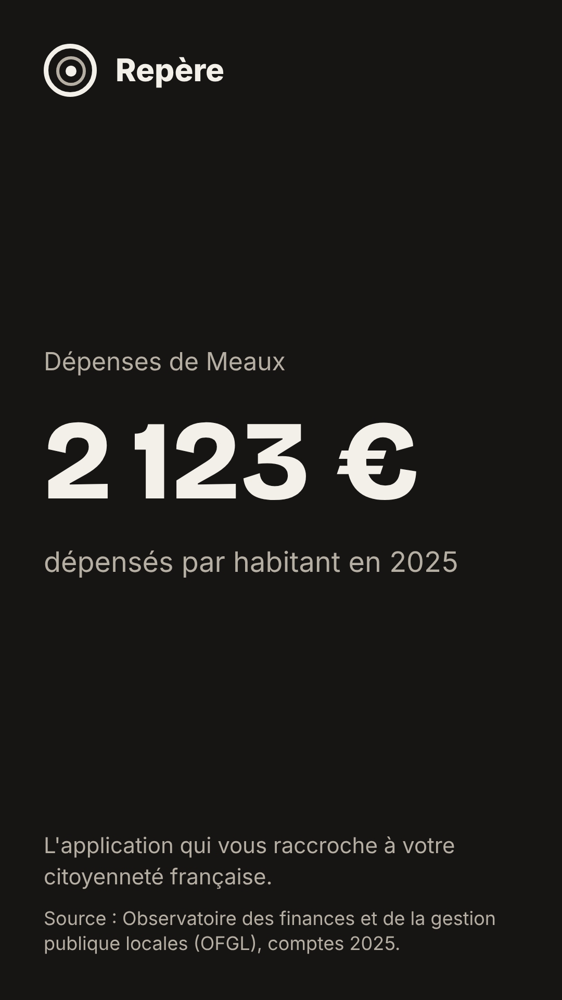
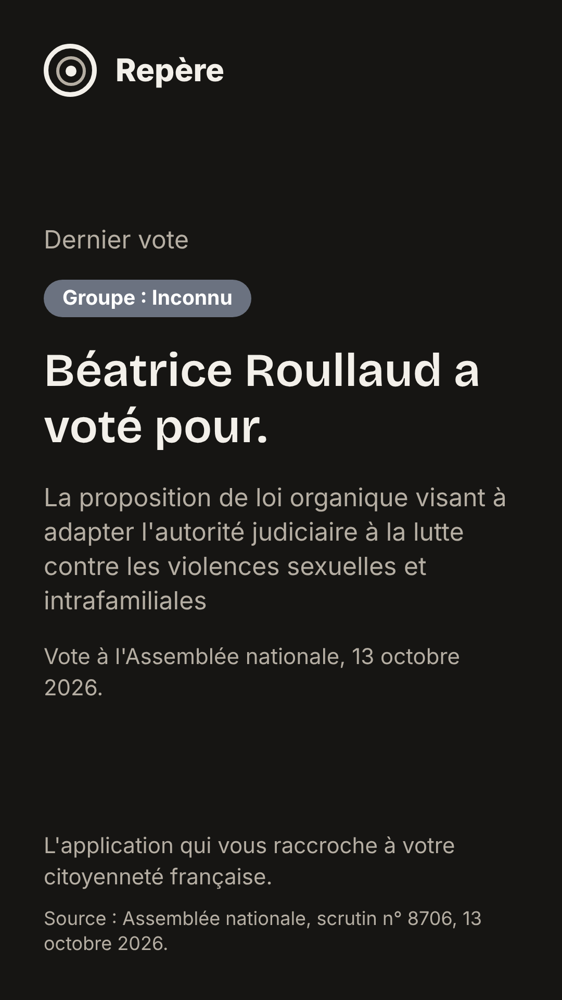
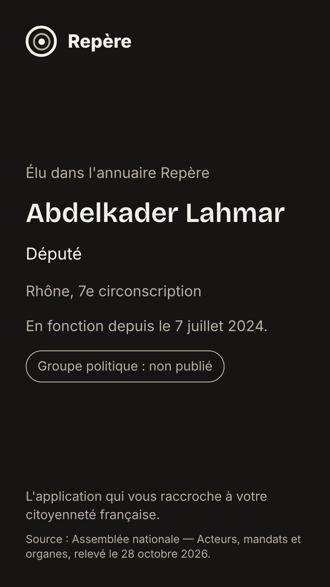

# Repère

Application civique française et neutre : pour une commune, **qui décide chez moi** et **où va mon argent**, chaque chiffre avec sa source officielle et sa date.

[](https://github.com/Repere0/repere/actions/workflows/collecte.yml)
[](https://github.com/Repere0/repere/actions/workflows/codeql.yml)
[](LICENSE)
[](.github/workflows/mobile.yml)


- Pas de compte, pas de publicité, pas de traceur. Après le premier chargement, l'application fonctionne hors ligne.
- La bêta couvre les 1 262 communes d'Île-de-France. L'application n'est pas encore publiée sur les magasins.
- Les règles qui ne bougent pas (neutralité, sources, aucun classement) sont dans [`CLAUDE.md`](CLAUDE.md), les décisions dans [`docs/adr/`](docs/adr/).





## Démarrage rapide

Prérequis : Node.js 22 et npm ; Expo Go sur un téléphone pour l'essayer sur mobile.

```sh
git clone https://github.com/Repere0/repere.git
cd repere/mono/apps/mobile
npm ci              # l'application a son propre package-lock.json, hors du workspace pnpm
npm run start       # puis scanner le QR code avec Expo Go
npm run web         # ou : version navigateur
npm run verifier    # vérification des types (tsc --noEmit)
```

L'application lit ses données publiées sur `https://repereapp.netlify.app/data` : il faut le réseau au premier chargement, ensuite les fichiers restent en cache.

Tests du monorepo, depuis `mono/` :

```sh
npx pnpm@8.15.9 install --frozen-lockfile
npm test            # certains tests demandent un navigateur Playwright
```

## Architecture

| Dossier | Contenu |
|---|---|
| `mono/apps/mobile` | L'application Expo (React Native, TypeScript) : écrans dans `src/app`, composants dans `src/ui`, logique dans `src/lib`. |
| `mono/packages/core` | Logique partagée (dates, formats, calculs), paquet `@repere/core`. |
| `mono/packages/data-utils` | Chargement, cache et contrôles des fichiers publics. |
| `mono/packages/ui` | Composants partagés. |
| `mono/scripts`, `outils/` | La chaîne de collecte des données publiques (`outils/pipeline.sh`), lancée chaque matin par `.github/workflows/collecte.yml`. |
| `data/` | Données publiées, brouillons générés (`data/auto/`), fiches de contenu. |
| `docs/` | Décisions (`adr/`), guides, audits ; `docs/historique/` garde les notes de version et rapports des versions précédentes. |
| `app_repere_v18_20.html` | L'application historique en un seul fichier ; ses blocs `REPERE_*` alimentent encore la chaîne. |

`BLOCAGES.md` liste ce qui n'est pas fait, pas vérifié, ou attend une décision.

## Contribuer

Lire [CONTRIBUTING.md](CONTRIBUTING.md). Pour une faille de sécurité, suivre [SECURITY.md](SECURITY.md) plutôt qu'ouvrir une issue publique. Les échanges suivent le [code de conduite](CODE_OF_CONDUCT.md).

## Licence

Le code est publié sous licence [AGPL-3.0](LICENSE). Les données affichées sont publiques : chacune indique son producteur, sa licence et sa date.

## Contact

Une erreur, une question, un retour de test : **repere0@protonmail.com**.
