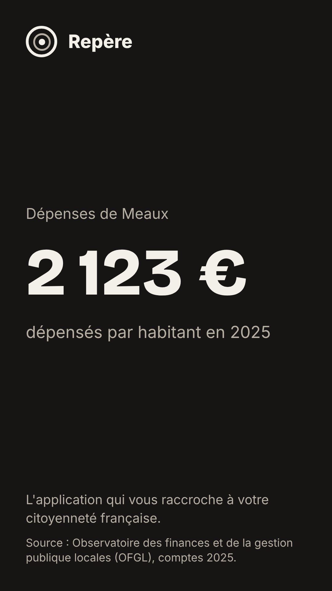
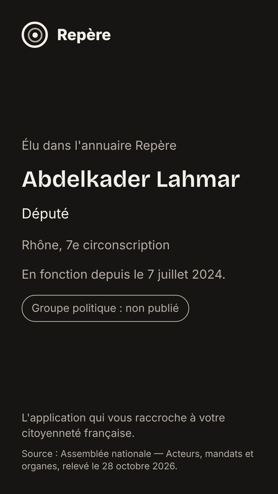

# Cartes de partage (story) — preuves visuelles

Date : 30/10/2026 (V20, bloc 3). Données publiées du 30/10/2026, commune Meaux.

## Les trois cartes

| Budget (écran « Où va l'argent ») | Vote (fiche élu) | Fiche de l'annuaire « Élus » |
|---|---|---|
|  |  |  |

## Vérifications (automatiques, `mono/apps/mobile/tests/partage-story-web.mjs`, et à l'œil)

| Point | Budget | Vote | Annuaire |
|---|---|---|---|
| 1080 × 1920, plus de 10 Ko | oui (108 Ko) | oui (160 Ko) | oui (126 Ko) |
| Logo en tête | oui | oui | oui |
| Couleur de groupe | sans objet | badge gris « Groupe : Inconnu » (aucun groupe publié) | pastille « Groupe politique : non publié » |
| Textes à 4,5:1 au moins sur le fond | oui | oui (le badge se mesure sur son propre fond) | oui |
| Source en pied | OFGL, comptes 2025 | Assemblée nationale, scrutin n° 8706, 13 octobre 2026 | Assemblée nationale, relevé du 28 octobre 2026 |
| Lien officiel | non, sur l'image | non, sur l'image : le numéro de scrutin y est, et l'adresse part dans le texte du partage (`messageVote`) | non |

- **Le logo est là** : le défaut historique (logo absent des captures, dû à la variante de couleur) ne touche pas ces cartes, qui utilisent la palette fixe `PALETTE_CARTE`.
- **Couleurs de parti** : aucune n'est visible, car aucun groupe n'est publié dans les données (tous « Inconnu »). Le jour où ils le seront, la couleur s'appliquera au badge seulement (ADR 0001).

## Ce qui n'est pas prouvé

- **Le PNG réel du téléphone.** Sur appareil, l'image est produite par `react-native-view-shot` (`captureRef`). Dans un navigateur, cette capture échoue : l'application partage alors le texte seul. Ces trois images sont la **même mise en page** (même code, rendu par react-native-web), photographiée par le navigateur à l'échelle 3. À vérifier une fois sur iPhone : bouton « Partager », puis regarder l'image dans la feuille de partage.
- **La carte du calendrier** : l'écran n'affiche le bouton que s'il y a une séance à venir. Dans les données de ce poste, les agendas de l'Assemblée et du Sénat sont absents, donc pas de carte. La fiche de l'annuaire la remplace ici.

## Petites incohérences relevées (non corrigées)

- La carte vote dit « Groupe : Inconnu », celle de l'annuaire « Groupe politique : non publié ». Même fait, deux formulations. À unifier.
- Le test de recouvrement (« la carte n'est recouverte par rien ») a été ajouté **après** avoir vu, sur une première capture, un bloc de l'écran passer sur la carte « budget ». C'était un défaut du test, pas de l'application. Il n'a pas été rejoué sur l'ancienne version du test pour prouver qu'il l'aurait détecté.

## Test automatique

Ajouté à `.github/workflows/mobile.yml`, après le parcours navigateur. Il échoue si :
- une carte ne fait pas 1080 × 1920 ou pèse moins de 10 Ko ;
- le logo manque ;
- un texte est sous 4,5:1 ;
- la source n'est pas en pied ;
- quelque chose recouvre la carte pendant la photo.
